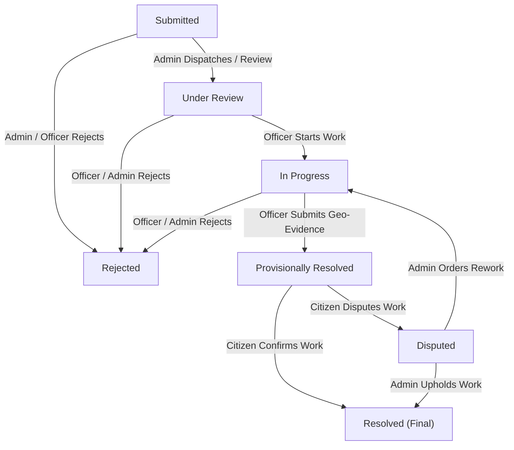
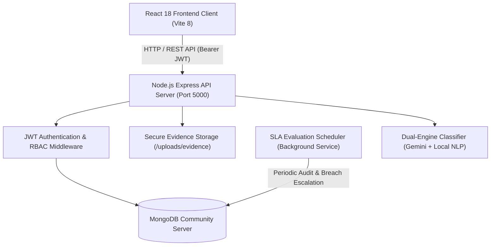

# CivicTrack 2.0 — Smart Civic Complaint Management and Resolution Platform

CivicTrack 2.0 is an enterprise-grade civic technology web platform designed to streamline the reporting, assignment, monitoring, resolution, and supervisory governance of municipal infrastructure and civic complaints (such as potholes, streetlighting outages, garbage accumulation, water supply interruptions, and drainage hazards).

The platform provides specialized, role-based workflows for **Citizens**, **Field Officers**, and **Municipal Administrators**, reinforced by:
1. **Geo-Verified Work Completion with Hybrid Citizen Approval**: Requiring mandatory photographic and GPS evidence from field officers, entering a provisional resolution milestone, and empowering citizens to confirm resolution or dispute unsatisfactory work.
2. **Smart SLA & Automated Escalation Engine**: Continuous municipal service level agreement tracking, automated breach detection, multi-tier escalation notifications, background evaluation scheduling, and supervisory administrative intervention controls.
3. **Cryptographic & Binary Verification**: Automated EXIF metadata extraction, Haversine physical distance validation, and binary magic-byte inspection.
4. **Single Administrative Governance**: Strict enforcement of a single-admin invariant across all write paths, preventing unauthorized privilege escalation.
5. **Role-Scoped Privacy**: Fine-grained data serialization (`toSafeObject()`) that protects internal supervisory notes and administrative actions from public or citizen exposure.
6. **Dual-Engine AI Intelligence**: Real-time category/priority classification with automatic offline NLP fallback and duplicate detection.

> **Academic Project Disclaimer:**  
> CivicTrack 2.0 is developed as an academic and educational engineering project. It is not currently deployed in production or officially integrated with any municipal corporation or government authority.

---

## Table of Contents

- [Core Innovations in CivicTrack 2.0](#core-innovations-in-civictrack-20)
- [Complaint Lifecycle State Machine](#complaint-lifecycle-state-machine)
- [Role-Based Feature Matrix](#role-based-feature-matrix)
- [Actual Technology Stack](#actual-technology-stack)
- [System Architecture](#system-architecture)
- [Project Directory Structure](#project-directory-structure)
- [Prerequisites & Verified Environment](#prerequisites--verified-environment)
- [Installation & Startup (Windows PowerShell)](#installation--startup-windows-powershell)
- [Environment Configuration](#environment-configuration)
- [Application Endpoints & Health Check](#application-endpoints--health-check)
- [Database Verification & Seed Accounts](#database-verification--seed-accounts)
- [API Reference & Access Controls](#api-reference--access-controls)
- [Testing & Comprehensive Test Suites](#testing--comprehensive-test-suites)
- [Security & Privacy Safeguards](#security--privacy-safeguards)
- [Known Limitations](#known-limitations)

---

## Core Innovations in CivicTrack 2.0

### 1. Geo-Verified Work Completion
- Field officers cannot arbitrarily close complaints or jump to `Resolved`.
- When work is done, officers must upload physical completion photographs and record device GPS coordinates (`POST /api/complaints/:id/complete-work`).
- The backend verifies:
  - Binary magic bytes (JPEG, PNG, WebP) and 10MB upload limits.
  - Device GPS vs. complaint coordinates (Haversine formula, 200m tolerance).
  - Embedded EXIF GPS tags vs. device coordinates (150m tolerance) with explicit verification audit trails.
- Successful completion moves the complaint to `Provisionally Resolved`.

### 2. Hybrid Citizen Approval & Dispute Workflow
- Once provisionally resolved, the citizen receives an in-app notification and an action banner on their dashboard.
- **Citizen Confirmation** (`POST /api/complaints/:id/confirm-resolution`): Citizen reviews the evidence, rates the work (1-5 stars), provides feedback, and transitions status to final `Resolved`.
- **Citizen Dispute** (`POST /api/complaints/:id/dispute`): If work is incomplete or substandard, the citizen disputes the claim with a required explanation (10-1000 chars) and optional dispute photo evidence. Status transitions to `Disputed`.
- **Admin Dispute Review** (`POST /api/complaints/:id/admin-review`): Administrators review disputed tickets and either:
  - Confirm resolution (`action: 'confirm_resolution'` &rarr; `Resolved`).
  - Order rework (`action: 'reopen_in_progress'` &rarr; `In Progress`), notifying both officer and citizen.

### 3. Smart SLA & Automated Escalation Engine
- **Configurable Policies**: Category and priority-specific resolution windows and warning thresholds defined in `backend/config/slaPolicy.js` and stored in `SlaPolicy` collection.
- **Dynamic Calculation**: Deadlines computed at creation; SLA state tracks elapsed hours, warning flags, breach flags, and escalation levels:
  - `Level 0`: Normal operation within SLA.
  - `Level 1`: Warning threshold reached (approaching deadline).
  - `Level 2`: Deadline breached.
  - `Level 3`: Critical breach (breached by &ge; 50% of SLA duration).
- **Background Scheduler**: Periodic background audit (`backend/services/slaScheduler.js`) evaluates open complaints, detects breaches, issues notifications, and flags Level 3 complaints for critical supervisory attention (`requiresCriticalAttention: true`).
- **Administrative Supervisory Controls**: Dedicated supervisory actions endpoint (`POST /api/sla/complaints/:id/actions`) enabling admins to:
  - Acknowledge critical escalations (`acknowledged`).
  - Record urgent interventions (`urgent_intervention`).
  - Conduct supervisory reviews (`supervisory_review`).
  - Log internal administrative notes (`admin_note`).
  - Reassign work orders to new officers (`reassign_officer`) with automated transition audit logs and notifications.

---

## Complaint Lifecycle State Machine



---

## Role-Based Feature Matrix

### 1. Citizen Features
- **Public Registration & Authentication**: Secure account creation via `POST /api/auth/register` (strictly restricted to `citizen` role) and JWT login.
- **Evidence-Backed Complaint Submission**:
  - Mandatory photo upload inspected for MIME type and binary magic bytes (JPEG, PNG, WebP).
  - Geolocation capture with automatic EXIF GPS extraction and Haversine distance verification.
  - Automated tracking ID generation (`CT-YYYYMMDD-XXXX`).
- **AI Civic Assistant**: Real-time suggestions for category and urgency/priority as the user types, with duplicate detection for complaints within the same ward.
- **Provisional Resolution Review**: Actionable banner on dashboard alerting citizens when work is provisionally resolved, with side-by-side inspection of initial vs. completion evidence.
- **Citizen Confirmation & Dispute Action**: One-click confirmation with star rating or structured dispute submission with dispute photos.
- **Interactive City Map**: Leaflet map rendering user-reported complaints with status-coded markers.
- **In-App Notifications**: Real-time updates for assignments, provisional resolutions, disputes, rework orders, and final closures.
- **Role-Scoped CSV Export**: Formula-sanitized CSV export of personal complaint records.

### 2. Field Officer Features
- **Dedicated Field Operations Dashboard**: Real-time summary cards (`Department Queue`, `Assigned to Me`, `Resolved / Closed`, and live `Overdue Tasks` tracking SLA breaches).
- **Assigned Complaints Queue**: Filtered list of complaints assigned to the logged-in officer with tracking ID and title search.
- **Field Work Completion Modal**:
  - Direct access via "Complete Work" button for `In Progress` tasks.
  - Mandatory photographic completion evidence upload with 10MB limit and magic byte checks.
  - Real-time device GPS coordinate acquisition via browser geolocation with 1-click capture.
  - Detailed resolution summary notes (10-2000 chars).
- **Enforced Status Lifecycle**: Cannot bypass completion evidence; invalid transitions (e.g. `In Progress` directly to `Resolved`) are rejected by backend.
- **Dispute Notices**: Visual alert banner informing officers if a previously submitted work order has been disputed by a citizen.
- **Field & Ward Map**: Geographic map visualizing assigned tasks across field jurisdictions.
- **Role-Scoped CSV Export**: Export assigned queue records with resolution metrics.

### 3. Municipal Administrator Features
- **Executive Operations Center**:
  - Real-time MongoDB `$facet` aggregation computing active issues, unassigned complaints, resolved count, and category breakdown.
  - Live calculated Average Response Time and Average Resolution Time.
  - Active `Overdue / Breached` metric card reflecting real-time SLA evaluations.
- **Dispatch & Assignment Center**:
  - Assign unassigned complaints to verified departmental field officers.
  - Reassign active work orders with mandatory administrative audit logs.
  - Automated dispatch notifications to assigned officers and citizens.
- **Dispute Review Interface**: Review citizen disputes, examine original, completion, and dispute evidence side-by-side, and decide whether to finalize resolution or order rework back to `In Progress`.
- **Supervisory SLA Escalation Management**:
  - Filter complaints by critical attention (`unacknowledged` / `acknowledged`).
  - View multi-departmental escalation dashboards (`GET /api/sla/dashboard`).
  - Execute supervisory actions: acknowledge escalations, order urgent interventions, log internal notes, and reassign officers.
  - Full audit trail of administrative actions strictly hidden from citizen view.
- **Officer & Department Workload Oversight**: Directory of field officers with caseload ratings (`Available / Idle`, `Optimal Load`, `Moderate`, `High Workload`) and in-app provisioning modal (`POST /api/auth/officers`).
- **City-Wide Geographic Command Map**: Full-screen Leaflet map displaying municipal complaints across all wards.
- **City-Wide Reporting & CSV Export**: Comprehensive data export filtered by department, status, category, or date range.

---

## Actual Technology Stack

| Layer | Technologies & Libraries | Notes |
| :--- | :--- | :--- |
| **Frontend UI** | React 18.3.1, Vite 8.3.4, Vanilla CSS Design System | Responsive desktop/tablet/mobile layout; no Tailwind dependency |
| **Mapping & GIS** | Leaflet 1.9.4, React-Leaflet, OpenStreetMap Tiles | Pure OpenStreetMap vector/raster tiles; no proprietary API key required |
| **Backend API** | Node.js (v20+ LTS / v24), Express 4.19.2 | RESTful JSON API with structured error handling |
| **Database** | MongoDB Community Server 8.x, Mongoose 8.3.2 | Strict schemas, lifecycle hooks, and single-admin invariant enforcement |
| **Authentication** | JWT (`jsonwebtoken` 9.0.2), `bcryptjs` 2.4.3 | Secure bearer tokens and 10-round salted password hashes |
| **File & Metadata** | Multer 1.4.5, ExifReader 4.23.1 | Binary magic-byte inspection, memory buffering, and EXIF extraction |
| **SLA Engine** | Native Node.js Timer / Cron Background Scheduler | Configurable SLA policy resolution and warning thresholds |
| **AI Classifier** | Dual-Engine: Google Gemini (`@google/genai`) + Local Rule-Based NLP | Pluggable cloud AI with 100% offline fallback |
| **Security Utilities** | Custom CSV sanitizer, Path traversal guard, Role serializer | Formula injection defense and role-scoped data masking |

---

## System Architecture



---

## Project Directory Structure

```text
CivicTrack/
├── backend/
│   ├── config/
│   │   ├── db.js                        # MongoDB connection lifecycle & error handlers
│   │   └── slaPolicy.js                 # Default municipal SLA configuration & matrix
│   ├── middleware/
│   │   ├── authMiddleware.js            # JWT verification and role-based authorization guards
│   │   └── uploadMiddleware.js          # Multer memory storage & magic-byte validator
│   ├── models/
│   │   ├── Complaint.js                 # Core Complaint model with schema, lifecycle & toSafeObject()
│   │   ├── Notification.js              # User notification schema and queries
│   │   ├── SlaPolicy.js                 # Configurable municipal SLA policy model
│   │   └── User.js                      # User schema with single-admin invariant hooks
│   ├── routes/
│   │   ├── authRoutes.js                # Login, register, me, officer provisioning
│   │   ├── complaintRoutes.js           # Complaint CRUD, complete-work, confirm, dispute, admin-review
│   │   ├── notificationRoutes.js        # Notification inbox, mark-read, mark-all
│   │   └── slaRoutes.js                 # SLA dashboard, policy config, critical attention & actions
│   ├── scripts/
│   │   ├── bootstrap-admin.js           # Idempotent administrator seed utility
│   │   ├── provision-user.js            # CLI utility for listing and creating user accounts
│   │   ├── verify-roles.js              # Test script verifying role invariant enforcement
│   │   ├── test_step2_schema_lifecycle.cjs # Test suite: Complaint lifecycle state machine
│   │   ├── test_step3_completion_evidence.cjs # Test suite: Officer work completion & EXIF verification
│   │   ├── test_step4_citizen_resolution.cjs # Test suite: Citizen confirmation, dispute & admin review
│   │   ├── test_step5_smart_sla.cjs     # Test suite: Smart SLA engine & escalation scheduler
│   │   ├── test_step6_escalation_actions.cjs # Test suite: Supervisory actions & admin controls
│   │   ├── test_step7_admin.cjs         # Test suite: Admin operational metrics & aggregation
│   │   ├── test_step8.cjs               # Test suite: EXIF, Maps, Notifications, CSV export
│   │   ├── test_step8_security_audit.cjs# Test suite: Single-admin invariant across all write paths
│   │   ├── test_step9.cjs               # Test suite: AI civic assistance & semantic classifier
│   │   └── test_step10_integration_security.cjs # Comprehensive integration & security test suite
│   ├── services/
│   │   └── slaScheduler.js              # Automated background SLA evaluation and escalation daemon
│   ├── uploads/
│   │   └── evidence/                    # Local storage for authenticated complaint photo evidence
│   ├── utils/
│   │   ├── aiService.js                 # Dual-engine AI classifier (Gemini + Local NLP fallback)
│   │   ├── csvSanitizer.js              # CSV formula injection defense utility
│   │   └── exifParser.js                # Pure JS EXIF GPS reader & Haversine formula calculation
│   ├── .env.example                     # Backend environment variable template
│   ├── app.js                           # Express application setup, CORS, and route mounting
│   ├── package.json                     # Backend dependencies and scripts
│   └── server.js                        # HTTP listener with database connection and pre-flight checks
│
├── frontend/
│   ├── public/                          # Static assets and icons
│   ├── src/
│   │   ├── components/
│   │   │   ├── AdminAssignmentModal.jsx # Modal for assigning/reassigning complaints to officers
│   │   │   ├── ComplaintDetailModal.jsx # Comprehensive modal displaying history, evidence, review forms
│   │   │   ├── Header.jsx               # Top navigation with role badge and live Notification Center
│   │   │   ├── IssueMap.jsx             # Interactive Leaflet map with OpenStreetMap tiles
│   │   │   ├── IssuesTable.jsx          # Sortable/filterable table of municipal complaints
│   │   │   ├── MyComplaintsList.jsx     # Citizen complaints view with search and filters
│   │   │   ├── OfficerComplaintsList.jsx# Officer queue view with work completion triggers
│   │   │   ├── OfficerWorkloadView.jsx  # Admin officer oversight and provisioning dashboard
│   │   │   ├── ReportIssueForm.jsx      # Multi-step complaint submission form with AI assistance
│   │   │   ├── ReportsView.jsx          # Dedicated reporting and CSV export interface
│   │   │   ├── Sidebar.jsx              # Responsive role-aware sidebar navigation
│   │   │   ├── StatCard.jsx             # Metric card component with consistent typography
│   │   │   ├── StatusUpdateModal.jsx    # Modal enforcing permitted status transitions and notes
│   │   │   ├── Toast.jsx                # Accessible floating toast notification banner
│   │   │   └── WorkCompletionModal.jsx  # Modal for officers to upload completion photo & device GPS
│   │   ├── context/
│   │   │   └── AuthContext.jsx          # React Context managing JWT token, user state, and logout
│   │   ├── services/
│   │   │   └── api.js                   # Centralized API service layer with error handling
│   │   ├── styles/
│   │   │   ├── dashboard.css            # Component styles for dashboards, tables, cards, modals
│   │   │   └── index.css                # Global design system tokens, typography, reset rules
│   │   ├── views/
│   │   │   ├── DashboardView.jsx        # Primary authenticated view routing modules by role
│   │   │   ├── LoginView.jsx            # Unified authentication view for all roles
│   │   │   └── RegisterView.jsx         # Public registration view for citizens
│   │   ├── App.jsx                      # Root application component with session checking
│   │   └── main.jsx                     # Application bootstrap and React DOM mount
│   ├── .env.example                     # Frontend environment variable template
│   ├── .oxlintrc.json                   # Linter configuration
│   ├── index.html                       # HTML entry point with meta tags and title
│   ├── package.json                     # Frontend dependencies and build scripts
│   └── vite.config.js                   # Vite configuration
│
├── docs/
│   └── DEMO_GUIDE.md                    # Complete live demonstration script and checklist
├── .gitignore                           # Git ignore rules for node_modules, .env, dist, and uploads
└── README.md                            # Comprehensive project documentation (this file)
```

---

## Prerequisites & Verified Environment

The following software versions have been verified on the development system:

- **Operating System:** Windows 10 / Windows 11 (PowerShell 5.1 / PowerShell 7+)
- **Node.js:** `v24.20.0` (Recommended: Node 20.x LTS or higher)
- **Package Manager:** `npm 11.19.0` (Included with Node)
- **Database:** `MongoDB Community Server 8.2.6` (Running locally on default port `27017`)
- **Web Browser:** Modern evergreen browser (Chrome, Edge, Firefox)

---

## Installation & Startup (Windows PowerShell)

Follow these steps to run CivicTrack locally on a Windows workstation using PowerShell.

### 1. Clone or Open the Workspace
```powershell
cd C:\Users\rites\OneDrive\Desktop\CivicTrack
```

### 2. Configure Environment Files
```powershell
# Backend configuration
Copy-Item backend\.env.example backend\.env

# Frontend configuration
Copy-Item frontend\.env.example frontend\.env
```

Ensure `backend\.env` contains a valid `JWT_SECRET` (at least 16 characters) and that `MONGO_URI` points to your local MongoDB service.

### 3. Install Dependencies
```powershell
# Install backend dependencies
cd backend
npm install

# Install frontend dependencies
cd ..\frontend
npm install

# Return to project root
cd ..
```

### 4. Ensure MongoDB is Running
```powershell
Get-Service -Name MongoDB
```
If not running, start it:
```powershell
Start-Service -Name MongoDB
```

### 5. Start Backend Server (Terminal 1)
```powershell
cd C:\Users\rites\OneDrive\Desktop\CivicTrack\backend
node server.js
```
Expected output:
```text
[Startup] Connecting to MongoDB...
[Database] MongoDB connection established successfully: civictrack
[SLA Scheduler] Background SLA evaluation daemon initialized (interval: 15m)
[Startup] CivicTrack backend server running on port 5000
[Startup] Health endpoint available at http://localhost:5000/api/health
```

### 6. Start Frontend Development Server (Terminal 2)
```powershell
cd C:\Users\rites\OneDrive\Desktop\CivicTrack\frontend
npm run dev
```
Expected output:
```text
  VITE v8.3.4  ready in 240 ms

  ➜  Local:   http://localhost:5173/
  ➜  Network: use --host to expose
```

---

## Environment Configuration

### Backend (`backend/.env`)

| Variable | Required | Default / Example | Purpose |
| :--- | :--- | :--- | :--- |
| `PORT` | No | `5000` | HTTP listening port for Express backend |
| `NODE_ENV` | No | `development` | Node environment (`development` / `production`) |
| `MONGO_URI` | **Yes** | `mongodb://127.0.0.1:27017/civictrack` | MongoDB connection string |
| `JWT_SECRET` | **Yes** | *(Secure random string &ge; 16 chars)* | Secret key used to sign and verify JWT tokens |
| `JWT_EXPIRES_IN` | No | `24h` | Expiration window for issued JWT tokens |
| `ALLOWED_ORIGINS`| No | `http://localhost:5173` | Comma-separated list of allowed CORS origins |
| `UPLOAD_DIR` | No | `./uploads/evidence` | Directory where uploaded evidence files are stored |
| `MAX_UPLOAD_SIZE_BYTES` | No | `10485760` (10MB) | Maximum file size allowed for evidence uploads |
| `SLA_EVALUATION_INTERVAL_MS`| No | `900000` (15m) | Frequency of automated SLA background evaluation |
| `GEMINI_API_KEY`| No | *(Optional API Key)* | Pluggable Google Gemini API key for AI categorization |

### Frontend (`frontend/.env`)

| Variable | Required | Default / Example | Purpose |
| :--- | :--- | :--- | :--- |
| `VITE_API_BASE_URL` | **Yes** | `http://localhost:5000` | Base URL used by frontend API client |

---

## Application Endpoints & Health Check

- **Frontend Application URL:** [http://localhost:5173](http://localhost:5173)
- **Backend API Base URL:** [http://localhost:5000](http://localhost:5000)
- **System Health Endpoint:** [http://localhost:5000/api/health](http://localhost:5000/api/health)

Verify backend health check via PowerShell:
```powershell
Invoke-RestMethod -Uri "http://localhost:5000/api/health" -Method Get
```
Response:
```json
{
  "status": "ok",
  "database": "connected",
  "uptime": 124.5,
  "timestamp": "2026-11-19T12:00:00.000Z"
}
```

---

## Database Verification & Seed Accounts

CivicTrack local database comes with verified pre-seeded accounts:

1. **Designated Administrator:**
   - Email: `admin@civictrack.gov`
   - Role: `admin` (Enforced Single Administrator)
   - ObjectId: `6ada551fb9374a2bdd26aff3`
2. **Field Officer:**
   - Email: `officer@civictrack.gov`
   - Role: `officer`
   - Department: `Roads & Infrastructure`
3. **Citizen:**
   - Email: `citizen@civictrack.gov`
   - Role: `citizen`

To verify database collections and the single-admin invariant:
```powershell
node backend/scripts/verify-roles.js
```

To view all registered accounts in the database:
```powershell
node backend/scripts/provision-user.js --list
```

---

## API Reference & Access Controls

All authenticated endpoints require a valid JWT header: `Authorization: Bearer <token>`.

### 1. Authentication & System
| Method | Endpoint | Access Level | Description |
| :--- | :--- | :--- | :--- |
| `GET` | `/api/health` | Public | System status, uptime, and database health |
| `POST` | `/api/auth/register` | Public | Citizen self-registration (`role: citizen` strictly enforced) |
| `POST` | `/api/auth/login` | Public | Unified login; returns JWT and scrubbed user profile |
| `GET` | `/api/auth/me` | Authenticated | Returns current authenticated user profile |
| `POST` | `/api/auth/officers` | **Admin Only** | Provisions a new field officer account |

### 2. Complaint Submission & Basic Management
| Method | Endpoint | Access Level | Description |
| :--- | :--- | :--- | :--- |
| `POST` | `/api/complaints` | Citizen | Submits new complaint with mandatory photo and location |
| `GET` | `/api/complaints/my` | Citizen | Paginated list of complaints created by the caller |
| `GET` | `/api/complaints/assigned`| Officer | Complaints assigned to calling officer (with SLA metadata) |
| `GET` | `/api/complaints/admin/all`| **Admin Only** | All complaints across city with admin SLA and action metadata |
| `GET` | `/api/complaints/:id` | Authenticated | Detailed complaint object (role-scoped serialization) |
| `PATCH`| `/api/complaints/:id/status`| Officer / Admin | Standard status transitions (Under Review &rarr; In Progress) |
| `PATCH`| `/api/complaints/:id/assign`| **Admin Only** | Assigns complaint to a verified field officer |
| `GET` | `/api/complaints/:id/evidence`| Owner / Assigned / Admin | Streams original complaint photo |

### 3. Geo-Verified Completion & Hybrid Approval
| Method | Endpoint | Access Level | Description |
| :--- | :--- | :--- | :--- |
| `POST` | `/api/complaints/:id/complete-work` | Assigned Officer | Submits completion photo, GPS & notes &rarr; `Provisionally Resolved` |
| `POST` | `/api/complaints/:id/confirm-resolution` | Complaint Owner | Citizen confirms work with rating/feedback &rarr; `Resolved` |
| `POST` | `/api/complaints/:id/dispute` | Complaint Owner | Citizen disputes work with explanation/photo &rarr; `Disputed` |
| `POST` | `/api/complaints/:id/admin-review` | **Admin Only** | Admin decides dispute: `confirm_resolution` or `reopen_in_progress` |
| `GET` | `/api/complaints/:id/evidence/completion`| Owner / Assigned / Admin | Streams authenticated completion photo |
| `GET` | `/api/complaints/:id/evidence/dispute`| Owner / Assigned / Admin | Streams authenticated dispute photo |

### 4. Smart SLA & Escalation Governance
| Method | Endpoint | Access Level | Description |
| :--- | :--- | :--- | :--- |
| `GET` | `/api/sla/policies` | Authenticated | Retrieves active municipal SLA policy matrix |
| `PUT` | `/api/sla/policies/:category/:priority`| **Admin Only** | Updates resolution and warning hours for category/priority |
| `POST` | `/api/sla/evaluate` | **Admin Only** | Manually triggers immediate system-wide SLA evaluation run |
| `GET` | `/api/sla/dashboard` | **Admin Only** | City-wide SLA metrics: breach rates, warnings, departmental compliance |
| `GET` | `/api/sla/critical-attention` | **Admin Only** | Retrieves high-priority Level 3 escalated complaints overview |
| `POST` | `/api/sla/complaints/:id/actions` | **Admin Only** | Records supervisory action (ack, review, intervention, note, reassign) |
| `GET` | `/api/sla/complaints/:id/actions` | **Admin Only** | Retrieves full audit log of administrative supervisory actions |

### 5. In-App Notifications & Reporting
| Method | Endpoint | Access Level | Description |
| :--- | :--- | :--- | :--- |
| `GET` | `/api/notifications` | Authenticated | Retrieves caller's notifications and unread counter |
| `PATCH`| `/api/notifications/:id/read`| Authenticated | Marks specific notification as read |
| `PATCH`| `/api/notifications/read-all`| Authenticated | Marks all notifications for caller as read |
| `POST` | `/api/complaints/ai/assist`| Authenticated | AI suggestions for category, priority, and duplicates |
| `GET` | `/api/complaints/export/csv`| Authenticated | Downloads role-scoped, formula-sanitized CSV export |

---

## Testing & Comprehensive Test Suites

CivicTrack 2.0 includes 11 automated test suites covering 100% of the platform's core functional, security, and lifecycle capabilities.

### Run All Test Suites
```powershell
# Step 2: Lifecycle State Machine Foundation (27 tests)
node backend/scripts/test_step2_schema_lifecycle.cjs

# Step 3: Work Completion & Geo-Verification API (35 tests)
node backend/scripts/test_step3_completion_evidence.cjs

# Step 4: Citizen Confirmation, Dispute & Admin Review (51 tests)
node backend/scripts/test_step4_citizen_resolution.cjs

# Step 5: Smart SLA Engine & Escalation Scheduler (51 tests)
node backend/scripts/test_step5_smart_sla.cjs

# Step 6: Automated Escalation Actions & Admin Controls (71 tests)
node backend/scripts/test_step6_escalation_actions.cjs

# Step 7: Admin Aggregation & Performance Metrics (30 tests)
node backend/scripts/test_step7_admin.cjs

# Step 8: Maps, Notifications, EXIF & CSV Export (47 tests)
node backend/scripts/test_step8.cjs

# Step 8 Security Audit: Single-Admin Invariant Enforcement (40 tests)
node backend/scripts/test_step8_security_audit.cjs

# Step 9: AI Civic Assistance & Semantic Classification (39 tests)
node backend/scripts/test_step9.cjs

# Step 10: Comprehensive Integration & Security Suite (54 tests)
node backend/scripts/test_step10_integration_security.cjs

# Role Invariant Verification (20 tests)
node backend/scripts/verify-roles.js
```
*Combined Total: 465+ automated test assertions passing (100% pass rate).*

### Frontend Production Build & Lint Verification
```powershell
# Verify frontend linter (0 errors expected)
npm --prefix frontend run lint

# Verify Vite production build (0 errors expected)
npm --prefix frontend run build
```

---

## Security & Privacy Safeguards

1. **Strict Single-Admin Invariant**:
   - Enforced across every Mongoose write method (`save`, `create`, `updateOne`, `updateMany`, `findOneAndUpdate`, `findByIdAndUpdate`) via schema pre-hooks.
   - Any attempt to register, promote, or inject a second administrative account is rejected with `400 Bad Request`.
2. **Role-Scoped Privacy & Serialization (`toSafeObject()`)**:
   - Complaint model exposes fine-grained serialization based on caller identity.
   - Internal administrative supervisory actions, escalation notes, and sensitive flags (`requiresCriticalAttention`) are strictly omitted for citizens and public requests, while providing clear, customer-friendly status notifications (`escalationNotice`).
3. **Multipart Binary Magic-Byte Inspection**:
   - Uploaded files are evaluated against actual binary signatures (JPEG `FF D8 FF`, PNG `89 50 4E 47`, WebP `52 49 46 46...57 45 42 50`), blocking file extension spoofing attacks.
4. **Canonical Path Traversal Guards**:
   - Evidence retrieval endpoints validate target paths using canonical normalization (`path.resolve()`), guaranteeing no files outside the designated evidence directory can ever be accessed.
5. **CSV Formula Injection Neutralization**:
   - All exported spreadsheet cells starting with `=`, `+`, `-`, `@`, `\t`, or `\r` are sanitized by prefixing with a single quote `'` and escaping with enclosing quotes, neutralizing remote command execution in Microsoft Excel and spreadsheet tools.
6. **Strict RBAC & Least-Privilege Evidence Streaming**:
   - Evidence endpoints enforce strict role checks: only the complaint creator, the assigned officer, or the administrator can stream photos; third parties receive `403 Forbidden`.

---

## Known Limitations

1. **Academic Demonstration Scope**: Designed for local academic evaluation and technical demonstration. It is not connected to active live emergency municipal call centers.
2. **Pluggable AI Key**: If `GEMINI_API_KEY` is not provided in `backend/.env`, the AI assistance engine automatically operates via its built-in local semantic NLP rule engine. This maintains 100% functionality without requiring external cloud accounts or incurring API costs.
3. **Browser Push Notifications**: Notifications are currently delivered via real-time database-backed in-app alerts and the top navigation notification center. Browser WebPush service worker subscriptions are not configured.

---

## Demonstration Guide

For step-by-step instructions on presenting the Citizen, Field Officer, and Administrator workflows in a live demonstration or classroom setting, refer to:  
👉 **[docs/DEMO_GUIDE.md](file:///c:/Users/rites/OneDrive/Desktop/CivicTrack/docs/DEMO_GUIDE.md)**
