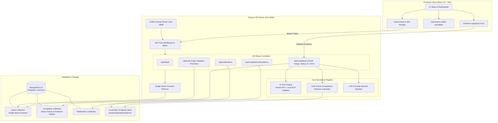

# CivicTrack — Smart Civic Complaint Management and Resolution Platform

CivicTrack is a full-stack civic technology web platform designed to streamline the reporting, assignment, monitoring, and resolution of municipal infrastructure and civic complaints (such as potholes, streetlighting outages, garbage accumulation, water supply interruptions, and drainage hazards).

The application provides specialized, role-based workflows for **Citizens**, **Field Officers**, and **Municipal Administrators**, reinforced by automated geographic validation, EXIF metadata inspection, AI-assisted civic intelligence, real-time in-app notifications, and secure CSV reporting.

> **Academic Project Disclaimer:**  
> CivicTrack is developed as an academic and educational engineering project. It is not currently deployed in production or officially integrated with any municipal municipal corporation or government authority.

---

## Table of Contents

- [Problem Statement \& Objectives](#problem-statement--objectives)
- [Role-Based Feature Matrix](#role-based-feature-matrix)
- [Actual Technology Stack](#actual-technology-stack)
- [System Architecture](#system-architecture)
- [Project Directory Structure](#project-directory-structure)
- [Prerequisites \& Verified Environment](#prerequisites--verified-environment)
- [Installation \& Startup (Windows PowerShell)](#installation--startup-windows-powershell)
- [Environment Configuration](#environment-configuration)
- [Application Endpoints \& Health Check](#application-endpoints--health-check)
- [Database Verification](#database-verification)
- [API Reference \& Access Controls](#api-reference--access-controls)
- [Testing \& Verification](#testing--verification)
- [Security \& Privacy Safeguards](#security--privacy-safeguards)
- [Known Limitations](#known-limitations)

---

## Problem Statement & Objectives

### The Problem
Traditional municipal complaint handling faces persistent structural barriers:
- **Lack of Verification:** Submitted reports often lack physical evidence or exact geolocation, leading to duplicate investigations and wasted municipal resources.
- **Opacity & Citizen Disconnect:** Citizens rarely receive structured status updates once a ticket is created, leading to dissatisfaction and repeated inquiries.
- **Inefficient Dispatching:** Administrators lack real-time visibility into departmental caseloads, resulting in unbalanced workloads across field officers.
- **Spreadsheet Security Hazards:** Civic reports exported to spreadsheets often expose agencies to CSV formula injection attacks (`=`, `+`, `@` execution).

### Project Objectives
1. **Verifiable Reporting:** Require authenticated physical photo evidence and validate declared geographic locations against embedded EXIF GPS tags using the Haversine formula.
2. **Deterministic Lifecycle Transitions:** Enforce a strict state machine (`Submitted` &rarr; `Under Review` &rarr; `In Progress` &rarr; `Resolved` / `Rejected`) preventing arbitrary or invalid status jumps.
3. **Single Administrative Governance:** Enforce a strict single-admin invariant across all database write paths and API layers to prevent unauthorized privilege escalation.
4. **Intelligent Civic Categorization:** Provide an AI assistance engine with automatic fallback to a local rule-based NLP classifier to suggest categories, priorities, and detect potential duplicate complaints.
5. **Role-Scoped Transparency:** Deliver dedicated dashboards, automated lifecycle notifications, interactive geographic maps, and formula-sanitized CSV exports tailored to each user role.

---

## Role-Based Feature Matrix

### 1. Citizen Features
- **Public Registration & Authentication:** Secure account creation via `POST /api/auth/register` (strictly restricted to `citizen` role) and JWT login.
- **Evidence-Backed Complaint Submission:**
  - Mandatory photo upload inspected for MIME type and binary magic bytes (JPEG, PNG, WebP).
  - Geolocation capture with automatic EXIF GPS extraction and Haversine distance verification.
  - Automated tracking ID generation (`CT-YYYYMMDD-XXXX`).
- **AI Civic Assistant:**
  - Real-time suggestions for category and urgency/priority as the user types.
  - Automatic detection of nearby potential duplicate complaints in the same ward.
- **Complaint Tracking & Details:**
  - Interactive table of personal complaints with search, category filtering, and status filters.
  - Detail modal displaying resolution timeline, assigned officer info, and authenticated evidence preview.
- **Interactive City Map:** Leaflet map rendering user-reported complaints with status-coded markers.
- **In-App Notifications:** Real-time updates when complaints are assigned, updated, or resolved.
- **Personal CSV Export:** Download personal complaint history with formula injection neutralization.

### 2. Field Officer Features
- **Dedicated Officer Dashboard:** Real-time summary cards (`Total Assigned`, `Under Review`, `In Progress`, `Resolved`, `Pending Actions`).
- **Assigned Complaints Queue:** Filtered list of complaints assigned to the logged-in officer with tracking ID and title search.
- **Controlled Status Transitions:**
  - Update complaint status strictly adhering to allowed transitions (`Submitted` &rarr; `Under Review`, `Under Review` &rarr; `In Progress`, `In Progress` &rarr; `Resolved` / `Rejected`).
  - Mandatory resolution notes required when marking an issue as `Resolved`.
  - Non-assigned or outside officers are strictly blocked by backend authorization checks.
- **Field & Ward Map:** Geographic map visualizing assigned tasks across field jurisdictions.
- **Role-Scoped CSV Export:** Export assigned queue records with resolution metrics.

### 3. Municipal Administrator Features
- **Executive Operations Center:**
  - Single MongoDB `$facet` aggregation computing real-time counts: Active/Open, Unassigned, Resolved, Rejected, and Breakdown by Category.
  - Real calculated Average Response Time and Average Resolution Time.
  - SLA overdue indicator clearly marked as awaiting municipal policy (no fabricated deadlines).
- **Officer & Department Workload Oversight:**
  - Interactive directory of all field officers with departmental caseload distribution.
  - Real-time capacity ratings (`Available / Idle`, `Optimal Load`, `Moderate`, `High Workload`).
  - Secure in-app provisioning modal for creating new field officers (`POST /api/auth/officers`).
- **Dispatch & Assignment Center:**
  - Assign unassigned complaints to verified departmental field officers.
  - Reassign or reallocate active work orders with administrative comments.
  - Triggers automated notifications to both the assigned officer and the reporting citizen.
- **City-Wide Geographic Command Map:** Full-screen Leaflet map displaying municipal complaints across all wards.
- **City-Wide Reporting & CSV Export:** Comprehensive data export filtered by department, status, category, or date range.

---

## Actual Technology Stack

| Layer | Technologies & Libraries | Notes |
| :--- | :--- | :--- |
| **Frontend UI** | React 18.3.1, Vite 8.3.4, Vanilla CSS Design System | Responsive desktop/tablet/mobile layout; no Tailwind dependency |
| **Mapping & GIS** | Leaflet 1.9.4, React-Leaflet, OpenStreetMap Tiles | Pure OpenStreetMap vector/raster tiles; no proprietary API key required |
| **Backend Runtime** | Node.js (Verified v24.20.0), Express 4.19.2 | RESTful JSON API with structured error handling |
| **Database & ODM** | MongoDB Community Server (Verified v8.2.6), Mongoose 8.4.1 | Schema validations, pre-save guards, aggregation pipelines |
| **Authentication** | JWT (jsonwebtoken 9.0.2), bcryptjs 2.4.3 | Cost factor 10, 24h expiration, single-admin invariant enforcement |
| **File & Metadata** | Multer 1.4.5-lts.1, Pure JS EXIF Parser | Binary magic-byte inspection, pure JS GPS IFD parsing |
| **Civic Intelligence**| Local Semantic NLP Classifier + Optional Google Gemini API | Privacy-first local engine by default; dual-engine Gemini integration |
| **Export Security** | Streaming CSV with Formula Injection Neutralization | Sanitizes `=`, `+`, `-`, `@`, `\t`, `\r` prefixes |
| **Code Quality** | Oxlint, Automated Custom Test Suites | Verified 209/209 test assertions passing; zero linter errors |

---

## System Architecture



---

## Project Directory Structure

```text
CivicTrack/
├── backend/
│   ├── config/
│   │   └── db.js                        # MongoDB Mongoose connection and lifecycle handlers
│   ├── middleware/
│   │   ├── authMiddleware.js            # JWT verification and role-based access control (RBAC)
│   │   └── uploadMiddleware.js          # Multer storage configuration with 10MB size ceiling
│   ├── models/
│   │   ├── Complaint.js                 # Schema for complaints, evidence subdocument, status history
│   │   ├── Notification.js              # Schema for user lifecycle notifications
│   │   └── User.js                      # Schema for users with single-admin pre-save invariant
│   ├── routes/
│   │   ├── authRoutes.js                # Login, citizen registration, admin officer provisioning
│   │   ├── complaintRoutes.js           # Submissions, assignments, status transitions, CSV, AI
│   │   ├── healthRoutes.js              # Health-check endpoint (/api/health)
│   │   └── notificationRoutes.js        # In-app notifications retrieval and read state updates
│   ├── scripts/
│   │   ├── bootstrap-admin.js           # Server-side CLI bootstrap script for single designated admin
│   │   ├── provision-user.js            # Internal CLI tool for listing and provisioning users
│   │   ├── verify-roles.js              # Verification script testing role invariant enforcement
│   │   ├── test_step7_admin.cjs         # Test suite: Admin operational metrics & aggregation
│   │   ├── test_step8.cjs               # Test suite: EXIF, Maps, Notifications, CSV export
│   │   ├── test_step8_security_audit.cjs# Test suite: Single-admin invariant across all write paths
│   │   ├── test_step9.cjs               # Test suite: AI civic assistance & semantic classifier
│   │   └── test_step10_integration_security.cjs # Comprehensive integration & security test suite
│   ├── uploads/
│   │   └── evidence/                    # Local storage for authenticated complaint photo evidence
│   ├── utils/
│   │   ├── aiService.js                 # Dual-engine AI classifier (Gemini + Local NLP fallback)
│   │   ├── csvSanitizer.js              # CSV formula injection defense utility
│   │   └── exifParser.js                # Pure JS EXIF GPS reader & Haversine formula calculation
│   ├── .env.example                     # Backend environment variable template
│   ├── app.js                           # Express application setup, CORS, and route mounting
│   ├── package.json                     # Backend dependencies and scripts
│   └── server.js                        # HTTP listener with database connection and pre-flight checks
│
├── frontend/
│   ├── public/                          # Static assets and icons
│   ├── src/
│   │   ├── components/
│   │   │   ├── AdminAssignmentModal.jsx # Modal for assigning/reassigning complaints to officers
│   │   │   ├── ComplaintDetailModal.jsx # Comprehensive modal displaying history, evidence, location
│   │   │   ├── Header.jsx               # Top navigation with role badge and live Notification Center
│   │   │   ├── IssueMap.jsx             # Interactive Leaflet map with OpenStreetMap tiles
│   │   │   ├── IssuesTable.jsx          # Sortable/filterable table of municipal complaints
│   │   │   ├── MyComplaintsList.jsx     # Citizen complaints view with search and filters
│   │   │   ├── OfficerComplaintsList.jsx# Officer queue view with status transition triggers
│   │   │   ├── OfficerWorkloadView.jsx  # Admin officer oversight and provisioning dashboard
│   │   │   ├── ReportIssueForm.jsx      # Multi-step complaint submission form with AI assistance
│   │   │   ├── ReportsView.jsx          # Dedicated reporting and CSV export interface
│   │   │   ├── Sidebar.jsx              # Responsive role-aware sidebar navigation
│   │   │   ├── StatCard.jsx             # Metric card component with consistent typography
│   │   │   ├── StatusUpdateModal.jsx    # Modal enforcing permitted status transitions and notes
│   │   │   └── Toast.jsx                # Accessible floating toast notification banner
│   │   ├── context/
│   │   │   └── AuthContext.jsx          # React Context managing JWT token, user state, and logout
│   │   ├── services/
│   │   │   └── api.js                   # Centralized API service layer with error handling
│   │   ├── styles/
│   │   │   ├── dashboard.css            # Component styles for dashboards, tables, cards, modals
│   │   │   └── index.css                # Global design system tokens, typography, reset rules
│   │   ├── views/
│   │   │   ├── DashboardView.jsx        # Primary authenticated view routing modules by role
│   │   │   ├── LoginView.jsx            # Unified authentication view for all roles
│   │   │   └── RegisterView.jsx         # Public registration view for citizens
│   │   ├── App.jsx                      # Root application component with session checking
│   │   └── main.jsx                     # Application bootstrap and React DOM mount
│   ├── .env.example                     # Frontend environment variable template
│   ├── .oxlintrc.json                   # Linter configuration
│   ├── index.html                       # HTML entry point with meta tags and title
│   ├── package.json                     # Frontend dependencies and build scripts
│   └── vite.config.js                   # Vite configuration
│
├── docs/
│   └── DEMO_GUIDE.md                    # Complete live demonstration script and checklist
├── .gitignore                           # Git ignore rules for node_modules, .env, dist, and uploads
└── README.md                            # Comprehensive project documentation (this file)
```

---

## Prerequisites & Verified Environment

The following software versions have been verified on the development system:

- **Operating System:** Windows 10 / Windows 11 (PowerShell 5.1 / PowerShell 7+)
- **Node.js:** `v24.20.0` (Recommended: Node 20.x LTS or higher)
- **Package Manager:** `npm 11.19.0` (Included with Node)
- **Database:** `MongoDB Community Server 8.2.6` (Running locally on default port `27017`)
- **Web Browser:** Modern evergreen browser (Chrome, Edge, Firefox)

---

## Installation & Startup (Windows PowerShell)

Follow these steps to run CivicTrack locally on a Windows workstation using PowerShell.

### 1. Clone or Open the Workspace
```powershell
cd C:\Users\rites\OneDrive\Desktop\CivicTrack
```

### 2. Configure Environment Files
Create local `.env` files from their respective examples:

```powershell
# Backend configuration
Copy-Item backend\.env.example backend\.env

# Frontend configuration
Copy-Item frontend\.env.example frontend\.env
```

Ensure `backend\.env` contains a valid `JWT_SECRET` (at least 16 characters) and that `MONGO_URI` points to your local MongoDB service.

### 3. Install Dependencies
```powershell
# Install backend dependencies
cd backend
npm install

# Install frontend dependencies
cd ..\frontend
npm install

# Return to project root
cd ..
```

### 4. Ensure MongoDB is Running
Verify your local MongoDB service is active:
```powershell
Get-Service -Name MongoDB
```
If not running, start it:
```powershell
Start-Service -Name MongoDB
```

### 5. Start Backend Server (Terminal 1)
Open a new PowerShell terminal and run:
```powershell
cd C:\Users\rites\OneDrive\Desktop\CivicTrack\backend
node server.js
```
Expected output:
```text
[Startup] Connecting to MongoDB...
[Database] MongoDB connection established successfully: civictrack
[Startup] CivicTrack backend server running on port 5000
[Startup] Health endpoint available at http://localhost:5000/api/health
```

### 6. Start Frontend Development Server (Terminal 2)
Open a second PowerShell terminal and run:
```powershell
cd C:\Users\rites\OneDrive\Desktop\CivicTrack\frontend
npm run dev
```
Expected output:
```text
  VITE v8.3.4  ready in 240 ms

  ➜  Local:   http://localhost:5173/
  ➜  Network: use --host to expose
```

---

## Environment Configuration

### Backend (`backend/.env`)

| Variable | Required | Default / Example | Purpose |
| :--- | :--- | :--- | :--- |
| `PORT` | No | `5000` | HTTP listening port for Express backend |
| `NODE_ENV` | No | `development` | Node environment (`development` / `production`) |
| `MONGO_URI` | **Yes** | `mongodb://127.0.0.1:27017/civictrack` | MongoDB connection string |
| `JWT_SECRET` | **Yes** | *(Secure random string &ge; 16 chars)* | Secret key used to sign and verify JWT tokens |
| `JWT_EXPIRES_IN` | No | `24h` | Expiration window for issued JWT tokens |
| `ALLOWED_ORIGINS`| No | `http://localhost:5173` | Comma-separated list of allowed CORS origins |
| `UPLOAD_DIR` | No | `./uploads/evidence` | Directory where uploaded evidence files are stored |
| `MAX_UPLOAD_SIZE_BYTES` | No | `10485760` (10MB) | Maximum file size allowed for evidence uploads |
| `GEMINI_API_KEY`| No | *(Optional API Key)* | Pluggable Google Gemini API key for AI categorization |

### Frontend (`frontend/.env`)

| Variable | Required | Default / Example | Purpose |
| :--- | :--- | :--- | :--- |
| `VITE_API_BASE_URL` | **Yes** | `http://localhost:5000` | Base URL used by frontend API client |

---

## Application Endpoints & Health Check

- **Frontend Application URL:** [http://localhost:5173](http://localhost:5173)
- **Backend API Base URL:** [http://localhost:5000](http://localhost:5000)
- **System Health Endpoint:** [http://localhost:5000/api/health](http://localhost:5000/api/health)

Verify the backend health check via PowerShell:
```powershell
Invoke-RestMethod -Uri "http://localhost:5000/api/health" -Method Get
```
Response:
```json
{
  "status": "ok",
  "database": "connected",
  "uptime": 124.5,
  "timestamp": "2026-10-28T11:15:00.000Z"
}
```

---

## Database Verification

To verify that your MongoDB database contains the necessary collections and adheres to the single-admin invariant, run:

```powershell
node backend/scripts/verify-roles.js
```

To view all registered accounts in the user directory:
```powershell
node backend/scripts/provision-user.js --list
```

### Initial Administrator Bootstrap
If setting up a fresh database without an admin, bootstrap the designated administrator via:
```powershell
node backend/scripts/bootstrap-admin.js
```
*Note: If an administrator account already exists, the script will cleanly detect it and exit without duplicating.*

---

## API Reference & Access Controls

All authenticated endpoints require a valid JWT passed in the HTTP header:  
`Authorization: Bearer <token>`

| Method | Endpoint | Access Level | Description |
| :--- | :--- | :--- | :--- |
| **System** | | | |
| `GET` | `/api/health` | Public | System status, uptime, and MongoDB connectivity |
| **Authentication** | | | |
| `POST` | `/api/auth/register` | Public | Citizen self-registration (`role: citizen` strictly enforced) |
| `POST` | `/api/auth/login` | Public | Unified login; returns JWT and scrubbed user profile |
| `GET` | `/api/auth/me` | Authenticated | Returns current authenticated user profile |
| `POST` | `/api/auth/officers` | **Admin Only** | Provisions a new field officer account |
| **Complaints & Workflows** | | | |
| `POST` | `/api/complaints` | Citizen | Creates a new complaint with mandatory photo evidence |
| `GET` | `/api/complaints/my` | Citizen | Returns paginated list of complaints created by the caller |
| `GET` | `/api/complaints/assigned`| Officer | Returns list of complaints assigned to the calling officer |
| `GET` | `/api/complaints/all` | **Admin Only** | Returns all complaints across all municipal departments |
| `GET` | `/api/complaints/:id` | Citizen / Officer / Admin | Returns detailed complaint with history (subject to ownership/assignment) |
| `PATCH`| `/api/complaints/:id/status`| Officer / Admin | Transitions complaint status following strict lifecycle rules |
| `PATCH`| `/api/complaints/:id/assign`| **Admin Only** | Assigns or reassigns complaint to a field officer |
| `GET` | `/api/complaints/:id/evidence`| Owner / Assigned / Admin | Streams authenticated evidence image with ownership check |
| **Civic Intelligence & Reporting** | | | |
| `POST` | `/api/complaints/ai/assist`| Authenticated | Returns category/priority suggestions and duplicate warnings |
| `GET` | `/api/complaints/export/csv`| Authenticated | Downloads role-scoped, formula-sanitized CSV report |
| `GET` | `/api/complaints/admin/summary`| **Admin Only** | MongoDB `$facet` aggregation of municipal operational metrics |
| `GET` | `/api/complaints/admin/officer-workload`| **Admin Only** | Officer capacity and departmental caseload distribution |
| `GET` | `/api/complaints/admin/officers`| **Admin Only** | Directory of active field officers for dispatch assignment |
| **Notifications** | | | |
| `GET` | `/api/notifications` | Authenticated | Retrieves recipient's in-app notifications and unread counter |
| `PATCH`| `/api/notifications/:id/read`| Authenticated | Marks a specific notification as read |
| `PATCH`| `/api/notifications/read-all`| Authenticated | Marks all notifications for caller as read |

---

## Testing & Verification

CivicTrack includes comprehensive automated test suites covering role-based security, state machines, EXIF geolocation, AI categorization, and operational metrics.

### Run All Integration & Security Tests
```powershell
node backend/scripts/test_step10_integration_security.cjs
```
*Expected Result: 54/54 assertions passing (100%).*

### Run Individual Test Suites
```powershell
# Step 7: Admin aggregation and officer workload metrics
node backend/scripts/test_step7_admin.cjs

# Step 8: Geotagged evidence, Leaflet maps, notifications, and CSV export
node backend/scripts/test_step8.cjs

# Step 8 Audit: Single-admin invariant enforcement across all write paths
node backend/scripts/test_step8_security_audit.cjs

# Step 9: AI civic intelligence and semantic NLP classification
node backend/scripts/test_step9.cjs
```

### Run Frontend Production Build & Linting
```powershell
cd frontend

# Run linter
npx oxlint src

# Run production build
npm run build
```
*Expected Result: Lint passes with 0 errors; Vite build completes successfully in `< 1000ms`.*

---

## Security & Privacy Safeguards

1. **Single-Admin Policy Invariant:**
   - CivicTrack strictly permits exactly one administrative user account.
   - Enforced across all Mongoose write paths (`save`, `create`, `updateOne`, `updateMany`, `findOneAndUpdate`, `findByIdAndUpdate`) via model middleware and query hooks.
   - Any attempt to create a second admin or update an existing user's role to `'admin'` is rejected with `400 Bad Request`.
2. **Password Security:**
   - Passwords hashed using `bcryptjs` with a cost factor of 10.
   - Passwords and sensitive fields are excluded by default in schema projections (`select: false`).
3. **Evidence Access Control:**
   - Uploaded photos are stored outside the public document root.
   - Evidence retrieval (`GET /api/complaints/:id/evidence`) enforces strict access control: only the citizen who submitted the complaint, the officer assigned to it, or the administrator can view or stream the photo. Unrelated parties receive `403 Forbidden`.
4. **Binary Magic Bytes Inspection:**
   - Uploaded files are inspected for real binary signatures (JPEG `FF D8 FF`, PNG `89 50 4E 47`, WebP `52 49 46 46...57 45 42 50`), neutralizing attacks involving renamed executables or script files.
5. **CSV Formula Injection Neutralization:**
   - All cells in exported CSV files starting with `= `, `+`, `-`, `@`, `\t`, or `\r` are sanitized by prefixing with a single quote `'` and escaping with enclosing quotes, neutralizing remote command execution in Microsoft Excel and spreadsheet tools.
6. **CORS Restrictions:**
   - Configured in `backend/app.js` to strictly permit local loopback origins (`localhost`, `127.0.0.1`) and explicit origins defined in `ALLOWED_ORIGINS`.

---

## Known Limitations

1. **Academic Prototype Scope:** This project is designed for local demonstration and evaluation. It is not currently deployed to cloud hosting or connected to municipal government dispatch systems.
2. **SLA Overdue Rules:** The platform does not currently enforce hardcoded municipal SLA deadline thresholds. The administrator metric for "Overdue" issues is explicitly designated as `isUnavailable` ("Awaiting municipal SLA policy") rather than presenting arbitrary or fabricated statistics.
3. **Pluggable AI Key:** If `GEMINI_API_KEY` is not provided in `backend/.env`, the AI assistance engine automatically operates via its built-in local semantic NLP rule engine. This maintains 100% functionality without requiring external cloud accounts or incurring API costs.
4. **Browser Push Notifications:** Notifications are currently delivered via real-time database-backed in-app alerts and the top navigation notification center. Browser WebPush service worker subscriptions are not configured.

---

## Demonstration Guide

For step-by-step instructions on presenting the Citizen, Field Officer, and Administrator workflows in a live demonstration or classroom setting, refer to:  
👉 **[docs/DEMO_GUIDE.md](file:///c:/Users/rites/OneDrive/Desktop/CivicTrack/docs/DEMO_GUIDE.md)**
